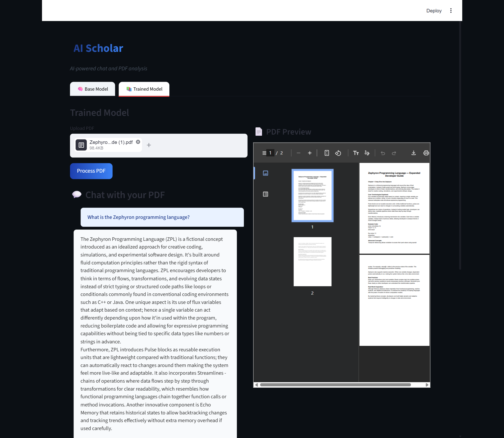
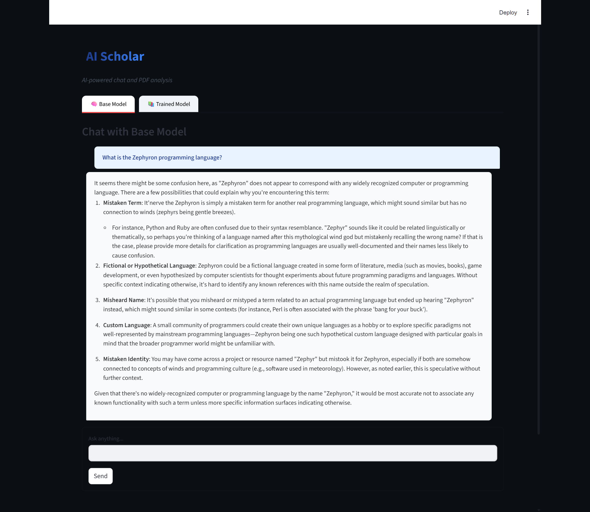

# 📚 Study Master (AI Scholar)

An **offline AI study assistant** that answers questions from your own PDFs. Upload a document,
ask a question, and a local language model answers **from the document**, not from what it memorised.
Everything runs on your own laptop through [Ollama](https://ollama.com): no internet, no account, no cost.

*Team project, March 2026.*



## The key test

To check the app really reads the PDF, we tested it on **documents we invented**, including a guide
to a made-up programming language called *Zephyron* (see `Content/`).

| Without the PDF (Base Model) | With the PDF (Trained Model) |
|---|---|
|  |  |
| The model has never heard of Zephyron. | It explains Zephyron correctly, from the document. |

## How it works (RAG: retrieval-augmented generation)

1. **Upload:** the PDF is shown in a preview next to the chat.
2. **Split:** the text is extracted with PyPDF2 and cut into ~300-word chunks.
3. **Embed:** each chunk becomes a vector with `nomic-embed-text` and is stored in a **FAISS** index.
4. **Retrieve:** the question is embedded too, and the 3 closest chunks are found.
5. **Answer:** only those chunks are sent to a local LLM, which writes the answer.

The app has two tabs:

- **🧠 Base Model:** plain chat with the local LLM.
- **📚 Trained Model:** chat grounded in your uploaded PDF.

## Tech stack

| Part | Tool |
|---|---|
| UI | Streamlit + custom CSS |
| LLM | Ollama (Mistral by default, phi3:mini for low-RAM laptops) |
| Embeddings | Ollama `nomic-embed-text` |
| Vector search | FAISS |
| PDF text | PyPDF2 |
| Language | Python |

## Run it

1. Install [Ollama](https://ollama.com) and pull the models:

   ```
   ollama pull nomic-embed-text
   ollama pull mistral        # or: ollama pull phi3:mini  (needs ~2 GB free RAM)
   ```

2. Install the Python packages:

   ```
   pip install -r requirements.txt
   pip install langchain-community
   ```

3. Start the app:

   ```
   streamlit run app.py
   ```

   To use a smaller model, set `OLLAMA_MODEL` first, for example in PowerShell:

   ```
   $env:OLLAMA_MODEL = "phi3:mini"; streamlit run app.py
   ```

`new_app.py` is an alternative layout of the same app. `OLLAMA_NIOS_LLM.ipynb` is the notebook used
while building and testing it.

## Project layout

```
app.py                  Main Streamlit app
new_app.py              Alternative layout of the app
OLLAMA_NIOS_LLM.ipynb   Development notebook
requirements.txt        Python dependencies
Content/                Invented test documents (Zephyron guide, fictional stories)
Screenshots/            Screenshots of the app
```

## Limitations

- Reads the first ~20,000 characters of one PDF at a time.
- Scanned (image-only) PDFs aren't supported yet.
- Chats aren't saved between sessions.
- Answers take about 10–30 seconds on a normal laptop.

## Ideas for later

Multiple PDFs at once, a saved vector database, OCR for scanned pages, and streaming answers.
